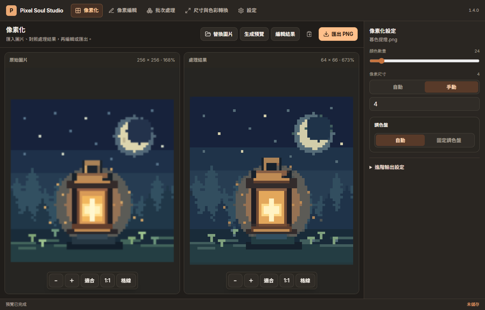
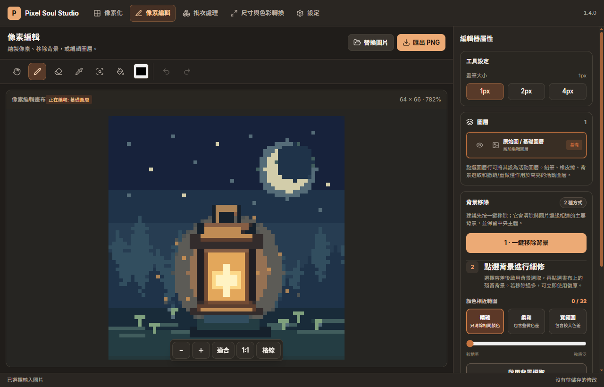

# Pixel Soul Studio

**在 Windows 上離線製作像素美術。** 匯入圖片，並排比較像素化前後，再用編輯器修圖、去背，或直接匯出 PNG。

[綠色版下載](#下載綠色版) · [功能導覽](#功能導覽) · [自行建置](#開發與建置)



## 功能導覽

| 工具 | 可以做什麼 |
| --- | --- |
| **像素化** | 開啟或拖入 PNG、JPG、WebP，調整像素尺寸和調色盤。按「生成預覽」比較結果，接著選擇「編輯結果」或直接匯出。 |
| **像素編輯** | 繪圖、去背、操作圖層，並復原或重做。匯出 PNG 時會合成可見圖層。 |
| **批次處理** | 選擇來源和輸出資料夾，以同一組設定和倍率處理多張圖片，並在同一頁查看進度。 |
| **尺寸與色彩轉換** | 調整尺寸、適配方式、色深和調色盤。畫布會即時預覽，PNG 匯出在上方工具列。 |

<details>
<summary>查看像素編輯器畫面</summary>



</details>

## 下載綠色版

Windows x64 綠色版會放在 [GitHub Releases](https://github.com/IllumiLove/PixelSoulStudio/releases)。下載 `PixelSoulStudio-Windows-x64.exe` 後，在 Windows 10 或 11 直接執行。若電腦缺少 WebView2 Runtime，可由 [Microsoft](https://developer.microsoft.com/microsoft-edge/webview2/#download) 安裝。

## 開發與建置

需要 Windows x64、Rust MSVC 工具鏈、Visual Studio Build Tools 的「使用 C++ 的桌面開發」工作負載、WebView2 Runtime、PowerShell 7 與 Node.js 20 以上。

```powershell
node --check frontend/assets/app.js
cargo test --locked --manifest-path desktop/Cargo.toml
cargo run --locked --manifest-path desktop/Cargo.toml
```

執行 `pwsh -File scripts/build-portable.ps1` 可在 `dist/` 產生單檔 EXE。`frontend/` 放的是桌面程式直接載入的 HTML、CSS 與 JavaScript，`desktop/` 是 Tauri 2 和 Rust 圖片處理介面，`third_party/` 保留內建的像素處理核心。

## 授權

自有程式碼採用 [0BSD](LICENSE)，可自由使用、二改、二次開發及再散布，包括商業用途。第三方元件依各自的授權條款提供，完整文字在 [第三方授權](frontend/third-party-notices.txt)，也可在程式的「設定」中閱讀。
